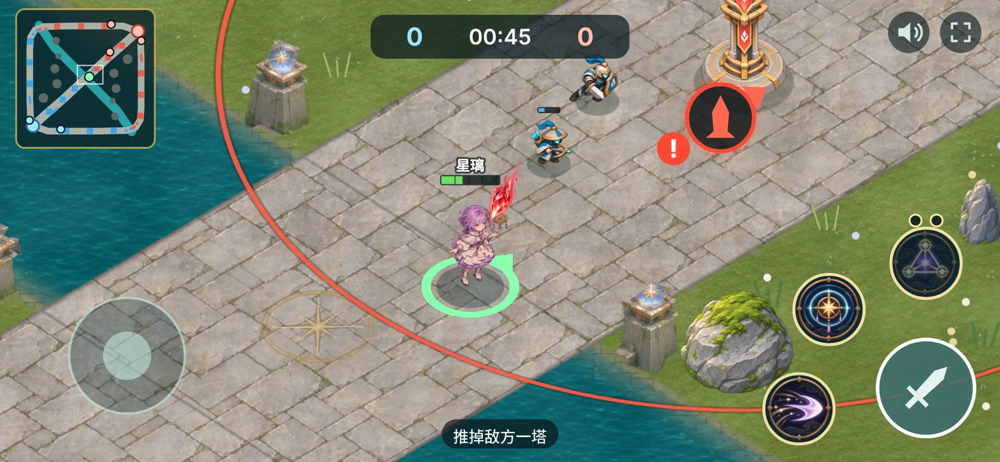

# 星阙峡谷 Xingque Canyon

手机横屏浏览器里的单人三路 MOBA 原型（3v3）。玩家操控蓝方英雄星璃，两名队友和三名对手由 AI 控制。

代码由 Claude 编写，美术由 Codex 生成，全程用自然语言提需求和验收。

A single-player 3-lane mobile MOBA prototype that runs in the browser. Code written by Claude, art generated by Codex.



演示视频：[docs/demo.mp4](docs/demo.mp4)

玩法演示（28 秒）：[docs/skills-mix.mp4](docs/skills-mix.mp4)

## 现在有什么

- 三路地图、兵线、寻路、防御塔（按外塔到内塔的顺序解锁）、基地水晶，一局可以打到结算
- 六名可选英雄，开局选人，对局中可随时换：星璃（法师）、玄垣（坦克）、鹤灯（辅助）、夜岚（刺客）、绯弦（射手）、赤檐（战士），每人三个技能
- 虚拟摇杆 + 普攻 + 三个技能；18 个技能各不相同，四种输入：点按、方向、落点、蓄力，拖到取消区松手取消。机制有格挡、推拉撞墙、伤害分担、治疗灯、连线、隐身、闪现、陷阱、圈地等（技能表见 [docs/DEVLOG.md](docs/DEVLOG.md) 的 v17 一节）
- 六名英雄、四种小兵的待机 / 跑步 / 攻击动画，技能特效和音效
- 固定斜俯视跟随镜头；敌塔攻击范围线、被锁定时的脚下红环和屏边箭头
- 草丛隐身、阵亡复活、AI 对线 / 撤退 / 避塔
- three.js（WebGL）渲染，出错时自动退回 Canvas 2D

在线试玩：https://linyitao519-alt.github.io/xingque-canyon/

这是原型：AI 英雄暂时只用普攻，英雄数值还没做平衡；中路这一屏打磨得最细，另外两路和基地的布景还是程序生成的；野怪未实装；真机帧率和手感仍在验证。

## 直接玩

- **单文件版**：下载 [`dist-single/xingque-canyon.html`](dist-single/xingque-canyon.html)（约 25MB，脚本、素材和 three.js 全部内嵌），双击打开即可，不需要服务器和网络。
- **本地服务器**（手机试玩用）：

  ```bash
  npm start          # 需要 Node.js 18+，无其他依赖；仓库里已带编译好的 dist/
  ```

  电脑打开 http://localhost:5173/ ；手机连同一 Wi-Fi，打开终端里打印的局域网地址，横屏。
- 仓库根目录的 `index.html` 用的都是相对路径，也可以用 GitHub Pages 托管（未实测）。

## 操作

| | |
|---|---|
| 左半屏 | 虚拟摇杆移动 |
| 右下大键 | 普攻（按住连续攻击） |
| 三个技能键 | 点一下直接放；按住拖动瞄准；拖到右上"取消"松手不放 |
| 键盘（桌面调试） | WASD 或方向键移动，J 或空格普攻，1 / 2 / 3 技能，结算后 R 重开 |

## 开发

```bash
npm install        # 只有 typescript 一个开发依赖
npm run build      # tsc 编译到 dist/
npm test           # 规则与动画测试（node:test）
python3 tools/build_single.py   # 重新生成单文件版（需要 Pillow）
```

浏览器端到端测试在 `tests/e2e_*.py`（Playwright for Python，真实多点触控，需要先 `npm start`）。无头浏览器里 WebGL 是软件渲染，实时项用 `XQ_BACKEND=canvas python3 tests/e2e_mobile.py` 跑。

目录：

```
src/            TypeScript 源码（sim 规则模拟、render 渲染、three_layer three.js 层、hud 触控、camrig 镜头、audio 音效）
assets/data/    地图、规则、布景（JSON，规则数值都在这里）
assets/         美术、动画帧带、特效、音效
lib/            three.js r128
tools/          素材导入、单文件打包脚本
tests/          测试
docs/           开发记录、对比图、真机测试清单
```

常用调试参数（加在网址后面）：`?r=canvas` 用 Canvas 渲染，`?fps=0` 关帧率显示，`?viewh=120` 旧屏高，`?aimcam=1` 开技能瞄准取景，`?towerring=0` 关塔范围线，`?hero=yelan` 指定英雄，`?debug=1` 调试标记，`?auto=1&speed=8` 自动对战快进，`?aiskills=1` 让 AI 英雄也用技能（默认关）。

完整的迭代过程和每一版的测量数据见 [docs/DEVLOG.md](docs/DEVLOG.md)。

## 许可

- 代码和数据：MIT，见 [LICENSE](LICENSE)
- 美术、动画、特效、音效：CC BY 4.0，见 [LICENSE-ASSETS.md](LICENSE-ASSETS.md)
- three.js：MIT，版权归 three.js 作者所有
